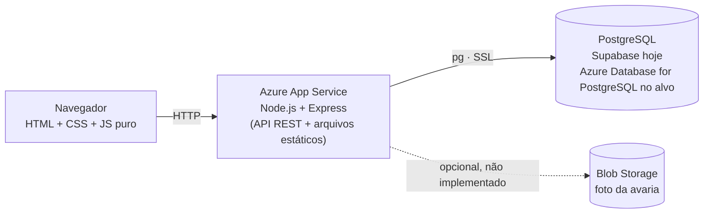
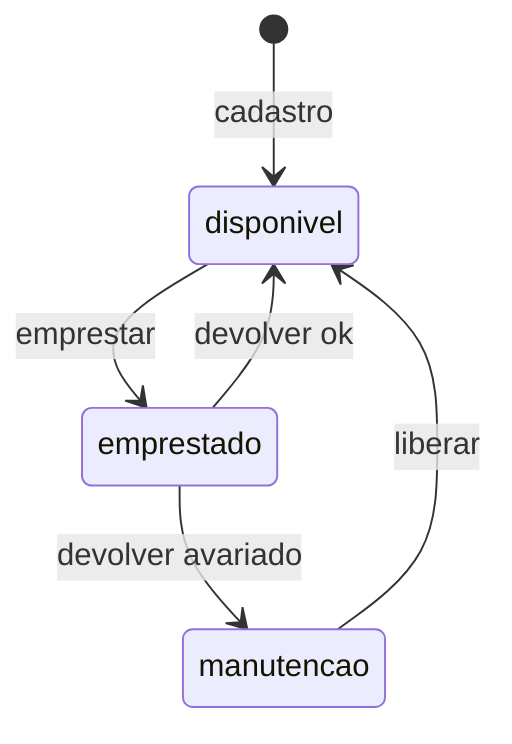
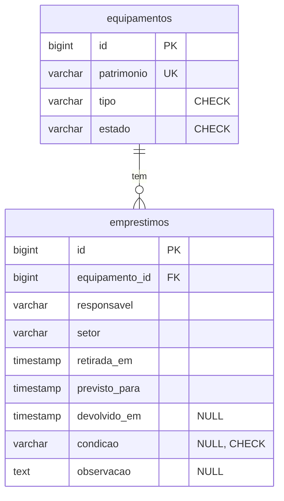

# Carrinho de Notebooks — Desafio 15

Sistema web para controlar o carrinho de equipamentos da escola (notebooks, projetores e câmeras): onde está cada item, com quem e em que estado.

**Integrantes:** André Salgado, Caio Victor, Camila Pessoa, Leticia Gabrielle, Luciana Borges, Priscila Barbosa

---

## 1. Problema e usuário

Os equipamentos do carrinho voltam danificados sem nenhum registro, e um projetor quebrado acaba sendo emprestado de novo na aula seguinte. O usuário é o **técnico responsável pelo carrinho**, que precisa saber onde está cada patrimônio, com quem e em que condição. O sistema impede emprestar equipamento avariado: ao devolver com defeito, o item vai para manutenção e só volta ao uso quando o técnico o libera.

---

## 2. Requisitos e status

| ID | Requisito | Status | Observação |
|---|---|---|---|
| RF1 | Cadastrar equipamento (patrimônio único, tipo notebook/projetor/camera, estado inicial `disponivel`) | ✅ Implementado | Sem teste automatizado (ver seção 7) |
| RF2 | Emprestar só equipamento `disponivel`, com responsável, setor e previsão futura de até 7 dias | ✅ Implementado e testado | 10 testes automatizados |
| RF3 | Devolver informando condição: `ok` → `disponivel`; `avariado` → `manutencao` (observação obrigatória) | ✅ Implementado e testado | Regra central; 8 testes automatizados |
| RF4 | Liberar da manutenção (→ `disponivel`) | ✅ Implementado | Sem teste automatizado |
| RF5 | Consultar "com quem está" um patrimônio e listar empréstimos atrasados | ✅ Implementado | Sem teste automatizado |
| CA1 | Emprestar equipamento já emprestado → 409 | ✅ Atendido | Testado |
| CA2 | Previsão de devolução no passado → 400 | ✅ Atendido | Testado (passado e "hoje" também dão 400) |
| CA3 | Devolução `avariado` sem observação → 400 | ✅ Atendido | Testado (vazia ou só espaços) |
| CA4 | Após devolução avariada, estado `manutencao` e novo empréstimo → 409 | ✅ Atendido | Coberto por dois testes (devolução avariada + empréstimo em manutenção) |
| CA5 | Consultar patrimônio emprestado retorna responsável e previsão | ✅ Implementado | Sem teste automatizado |
| Extra | Histórico de empréstimos (view `historico_equipamentos`) | ✅ Implementado | Não pedido na ficha |
| Extra | Excluir equipamento (bloqueado se emprestado ou com histórico) | ✅ Implementado | Não pedido na ficha |
| Extra | Modo demo no front-end (dados no navegador) | ✅ Implementado | Entra sozinho se a API não responder |
| Opcional | Foto da avaria no Blob Storage | ⛔ Não implementado | Ver próximos passos |
| Nível C | Plano de implantação na Azure | 📝 Documentado | Seção 5 |

---

## 3. Arquitetura



O Express serve o front-end (`/frontend`) e a API na mesma origem, então não há CORS a configurar. A lógica de empréstimo e devolução fica em `backend/src/services/emprestimos.js`, isolada das rotas, o que permite testá-la com um banco falso.

### Máquina de estados



Não existe transição `manutencao → emprestado`: é isso que garante o CA4.

### Decisão justificada: estado guardado no equipamento

**Escolha:** a coluna `equipamentos.estado` guarda o estado atual, em vez de derivá-lo do histórico de empréstimos.

**O que se ganha**
- **Concorrência simples e segura.** O empréstimo é um `UPDATE equipamentos SET estado = 'emprestado' WHERE id = $1 AND estado = 'disponivel'`. O banco decide atomicamente quem vence; o segundo pedido recebe 0 linhas e a API responde 409. Não há "checar e depois gravar" com janela de corrida.
- **Leituras baratas.** A listagem e o painel filtram por uma coluna, sem agregar histórico.
- **Regra no banco.** Um `CHECK` limita os valores possíveis de `estado`.
- **Manutenção sem tabela extra.** O estado `manutencao` não é consequência de um empréstimo: ele só se resolve com a ação de liberar, que não tem linha própria em `emprestimos`. Derivar o estado exigiria criar uma tabela de manutenções.

**O que se perde**
- **Duas fontes da verdade.** `equipamentos.estado` e o empréstimo aberto (`devolvido_em IS NULL`) podem divergir se algo gravar um sem o outro. Mitigação: empréstimo e devolução rodam em **uma única transação** (`BEGIN` … `COMMIT`, `ROLLBACK` em qualquer falha), e a devolução confere que o equipamento está mesmo `emprestado` antes de mudar o estado (senão, 409).
- **Sem trilha das mudanças de estado.** Só o empréstimo fica no histórico; a liberação da manutenção não deixa registro de quem liberou nem quando.

**Diferença em relação a uma biblioteca:** num livro, devolver significa "voltou para a estante". Aqui o **estado físico** do item importa: a devolução carrega uma condição (`ok` ou `avariado`) que decide para onde o item vai, e o item avariado fica bloqueado para novos empréstimos até uma ação explícita do técnico.

---

## 4. Modelo de dados

> Reconstituído a partir da ficha, do código e dos prints do Supabase. Confira com o banco real (Table Editor → Definition) antes de entregar.



### Restrições

| Tabela | Coluna | Restrição |
|---|---|---|
| `equipamentos` | `id` | Chave primária |
| `equipamentos` | `patrimonio` | `NOT NULL`, **`UNIQUE`** (duplicado → erro `23505` → API responde 409) |
| `equipamentos` | `tipo` | `NOT NULL`, `CHECK (tipo IN ('notebook','projetor','camera'))` |
| `equipamentos` | `estado` | `NOT NULL`, `CHECK (estado IN ('disponivel','emprestado','manutencao'))`, padrão `disponivel` |
| `emprestimos` | `equipamento_id` | **FK** para `equipamentos(id)`, `NOT NULL`. Impede apagar equipamento com histórico (erro `23503` → 409) |
| `emprestimos` | `responsavel`, `setor` | `NOT NULL` |
| `emprestimos` | `retirada_em` | `NOT NULL`, padrão `CURRENT_TIMESTAMP` |
| `emprestimos` | `previsto_para` | `NOT NULL` |
| `emprestimos` | `devolvido_em` | Aceita `NULL`. `NULL` significa empréstimo ativo |
| `emprestimos` | `condicao` | Aceita `NULL`, `CHECK (condicao IN ('ok','avariado'))` |
| `emprestimos` | `observacao` | Aceita `NULL` |

**Regras aplicadas só na API (não no banco):** previsão futura e de no máximo 7 dias; observação obrigatória quando `condicao = 'avariado'`.

---

## 5. Como executar

### 5.1 Pré-requisitos

- Node.js 18 ou superior (o projeto usa Express 5)
- Um banco PostgreSQL acessível (hoje, o projeto `carrinho-escola` no Supabase)

### 5.2 Variáveis de ambiente

Crie `backend/.env` (não vai para o GitHub):

| Variável | Obrigatória | Descrição |
|---|---|---|
| `DATABASE_URL` | Sim | String de conexão PostgreSQL. No Supabase: botão **Connect** do painel |
| `PORT` | Não | Porta da API. Padrão `3000` |

Nunca coloque a senha do banco no código nem a envie por mensagem pública.

### 5.3 Scripts do banco

Execute no **SQL Editor** do Supabase (ou com `psql`) para criar a estrutura do zero:

```sql
-- Tabelas
CREATE TABLE equipamentos (
  id         BIGINT GENERATED ALWAYS AS IDENTITY PRIMARY KEY,
  patrimonio VARCHAR NOT NULL UNIQUE,
  tipo       VARCHAR NOT NULL CHECK (tipo IN ('notebook','projetor','camera')),
  estado     VARCHAR NOT NULL DEFAULT 'disponivel'
             CHECK (estado IN ('disponivel','emprestado','manutencao'))
);

CREATE TABLE emprestimos (
  id             BIGINT GENERATED ALWAYS AS IDENTITY PRIMARY KEY,
  equipamento_id BIGINT NOT NULL REFERENCES equipamentos(id),
  responsavel    VARCHAR NOT NULL,
  setor          VARCHAR NOT NULL,
  retirada_em    TIMESTAMP NOT NULL DEFAULT CURRENT_TIMESTAMP,
  previsto_para  TIMESTAMP NOT NULL,
  devolvido_em   TIMESTAMP NULL,
  condicao       VARCHAR NULL CHECK (condicao IN ('ok','avariado')),
  observacao     TEXT NULL
);

-- Views usadas pelo painel
CREATE VIEW historico_equipamentos AS
SELECT e.patrimonio, e.tipo, emp.responsavel, emp.setor,
       emp.retirada_em, emp.previsto_para,
       emp.devolvido_em, emp.condicao, emp.observacao
FROM emprestimos emp
JOIN equipamentos e ON e.id = emp.equipamento_id;

CREATE VIEW emprestimos_atrasados AS
SELECT emp.id AS emprestimo_id, e.patrimonio, e.tipo,
       emp.responsavel, emp.setor, emp.retirada_em, emp.previsto_para
FROM emprestimos emp
JOIN equipamentos e ON e.id = emp.equipamento_id
WHERE emp.devolvido_em IS NULL
  AND emp.previsto_para < CURRENT_TIMESTAMP;
```

Dados de exemplo (opcional):

```sql
INSERT INTO equipamentos (patrimonio, tipo) VALUES
  ('NB-001', 'notebook'),
  ('NB-002', 'notebook'),
  ('PJ-001', 'projetor');
```

### 5.4 Comandos

```bash
git clone <url-do-repositorio>
cd carrinho-escola/backend
npm install
npm start                       # sobe API + front em http://localhost:3000
curl http://localhost:3000/health
# esperado: {"status":"ok","banco":"conectado"}
```

Abra `http://localhost:3000` no navegador para usar a interface (abas Equipamentos, Emprestar, Devolver, Atrasados e Histórico).

| Comando (em `backend/`) | O que faz |
|---|---|
| `npm start` | Sobe o servidor |
| `npm test` | Roda os testes (`node --test`), sem precisar de banco |

### 5.5 Rotas da API

| Método e rota | Ação | Respostas principais |
|---|---|---|
| `POST /api/equipamentos` | Cadastrar (RF1) | 201, 400 (tipo inválido), 409 (patrimônio duplicado) |
| `GET /api/equipamentos` | Listar com empréstimo ativo | 200 |
| `DELETE /api/equipamentos/:patrimonio` | Excluir | 200, 404, 409 |
| `POST /api/emprestimos` | Emprestar (RF2). Corpo: `patrimonio`, `responsavel`, `setor`, `previsaoDevolucao` (`AAAA-MM-DD`) | 201, 400, 404, 409 |
| `PATCH /api/emprestimos/:id/devolver` | Devolver (RF3). Corpo: `condicao` (`ok`/`avariado`), `observacao` | 200, 400, 404, 409 |
| `PATCH /api/equipamentos/:patrimonio/liberar` | Liberar da manutenção (RF4) | 200, 404, 409 |
| `GET /api/equipamentos/:patrimonio/com-quem` | Com quem está (RF5) | 200, 404 |
| `GET /api/emprestimos/atrasados` | Atrasados (RF5) | 200 |
| `GET /api/historico` | Histórico | 200 |
| `GET /health` | Verifica API e banco | 200, 500 |

### 5.6 Plano de implantação na Azure (Nível C)

**Alvo:** Navegador → **Azure App Service** (Node.js, Linux) → **PostgreSQL**. O repositório já traz a base disso: `.deployment` com `SCM_DO_BUILD_DURING_DEPLOYMENT=true` (a Azure roda `npm install` no deploy) e a configuração da extensão Azure App Service do VS Code apontando para o grupo de recursos `rg-cloud-g4` e o app `app-cloud-g4-iniciais`.

**Passo 1. Recursos**

```bash
az group create -n rg-cloud-g4 -l brazilsouth
az appservice plan create -g rg-cloud-g4 -n plan-cloud-g4 --is-linux --sku B1
az webapp create -g rg-cloud-g4 -p plan-cloud-g4 -n app-cloud-g4-iniciais --runtime "NODE:20-lts"
```

**Passo 2. Banco (duas opções)**

| Opção | Quando usar | O que fazer |
|---|---|---|
| **A. Manter o Supabase** | Menor mudança e sem custo extra | Usar a string do **Session pooler** em `DATABASE_URL`. A conexão direta do Supabase depende de IPv6 e pode falhar, como no problema da seção 8 |
| **B. Azure Database for PostgreSQL (Flexible Server)** | Tudo dentro da Azure, como sugere a ficha | Criar o servidor, liberar o acesso do App Service no firewall, rodar o script da seção 5.3 com `psql` e usar `sslmode=require` na string |

Como o código usa só o driver `pg`, trocar de A para B muda apenas a `DATABASE_URL` e a execução do script.

**Passo 3. Configuração do app (nunca no código)**

```bash
az webapp config appsettings set -g rg-cloud-g4 -n app-cloud-g4-iniciais \
  --settings DATABASE_URL="<string-de-conexao>" SCM_DO_BUILD_DURING_DEPLOYMENT=true
```

A Azure injeta a variável `PORT`, que o `app.js` já lê.

**Passo 4. Ajuste necessário no repositório antes do primeiro deploy**

A configuração do VS Code publica a **raiz** do repositório (`deploySubpath: "."`), mas o `package.json` está em `backend/`. Sem um `package.json` na raiz, a Azure não detecta o Node nem roda o `npm install`. Como o `app.js` serve `../../frontend`, publicar só a pasta `backend/` também não serve. Solução: criar `package.json` na raiz:

```json
{
  "name": "carrinho-escola",
  "private": true,
  "scripts": {
    "postinstall": "npm install --prefix backend",
    "start": "node backend/src/app.js"
  }
}
```

**Passo 5. Deploy:** pela extensão Azure App Service do VS Code (já configurada) ou por `az webapp deploy --type zip`. Ignorar `node_modules` e `.vscode`, como já está em `settings.json`.

**Passo 6. Verificação:** abrir `https://app-cloud-g4-iniciais.azurewebsites.net/health` e esperar `{"status":"ok","banco":"conectado"}`; depois executar um empréstimo e uma devolução avariada pela interface. No portal, configurar **Health check** do App Service com o caminho `/health` e acompanhar os logs em **Log stream**.

**Passo 7 (opcional). Blob Storage:** criar uma conta de armazenamento e um contêiner privado para a foto da avaria, guardando o nome do arquivo em uma nova coluna de `emprestimos`.

---

## 6. Estrutura do projeto

```
carrinho-escola/
├── backend/
│   ├── src/
│   │   ├── app.js                  # servidor Express, /health e arquivos estáticos
│   │   ├── db/pool.js              # conexão com o PostgreSQL
│   │   ├── routes/
│   │   │   ├── equipamentos.js     # RF1, RF4, RF5, listar, excluir, histórico
│   │   │   └── emprestimos.js      # RF2 e RF3 (delegam ao service)
│   │   └── services/emprestimos.js # regras de negócio e transações
│   └── tests/emprestimos.test.js
├── frontend/                       # HTML, CSS e JS puro (ver frontend/README.md)
├── .deployment                     # build no deploy da Azure
└── settings.json                   # configuração da extensão Azure do VS Code
```

---

## 7. Casos de teste

### 7.1 Automatizados (`npm test`): 18 de 18 passando

Os testes sobem a API com um **banco falso em memória** que imita as transações (inclusive `ROLLBACK`). Eles validam as regras de negócio, não o SQL contra o PostgreSQL real.

| # | Caso | Resultado esperado | Cobre |
|---|---|---|---|
| 1 | Emprestar equipamento disponível | 201, equipamento vira `emprestado` | RF2 |
| 2 | Emprestar patrimônio inexistente | 404 | RF2 |
| 3 | Emprestar equipamento já emprestado | 409 | **CA1** |
| 4 | Emprestar equipamento em manutenção | 409 | **CA4** (parte final) |
| 5 | Previsão no passado ou hoje | 400 | **CA2** |
| 6 | Previsão acima de 7 dias | 400 | RF2 |
| 7 | Previsão no limite de 7 dias | 201 | RF2 |
| 8 | Data inválida ou campos ausentes | 400 | RF2 |
| 9 | Dois empréstimos simultâneos do mesmo equipamento | Só um vence | RF2 (concorrência) |
| 10 | Falha do banco ao registrar o empréstimo | Rollback: equipamento volta a `disponivel` | RF2 (transação) |
| 11 | Devolução em boas condições (`ok`) | Equipamento `disponivel` | RF3 |
| 12 | Devolução `avariado` com observação | Equipamento `manutencao` | RF3, **CA4** (parte inicial) |
| 13 | `avariado` sem observação (vazia ou só espaços) | 400 e nada muda | **CA3** |
| 14 | Condição inválida | 400 | RF3 |
| 15 | Empréstimo inexistente / id inválido | 404 / 400 | RF3 |
| 16 | Devolver empréstimo já finalizado | 409 e equipamento intacto | RF3 |
| 17 | Devolução altera só o equipamento do empréstimo | Outros equipamentos intactos | RF3 |
| 18 | Falha do banco durante a devolução | Rollback do empréstimo | RF3 (transação) |

### 7.2 Manuais (sem teste automatizado)

> Status **A executar**: rodar contra a API real e preencher a coluna final.

| # | Caso | Ação | Resultado esperado | Cobre | Resultado |
|---|---|---|---|---|---|
| M1 | Cadastrar equipamento | `POST /api/equipamentos` com `NB-010`, `notebook` | 201, estado `disponivel` | RF1 | A executar |
| M2 | Patrimônio duplicado | Repetir M1 | 409 | RF1 | A executar |
| M3 | Tipo inválido | `POST` com tipo `tablet` | 400 | RF1 | A executar |
| M4 | Liberar da manutenção | `PATCH .../liberar` em item em `manutencao` | 200, estado `disponivel` | RF4 | A executar |
| M5 | Liberar item que não está em manutenção | `PATCH .../liberar` em item `disponivel` | 409 | RF4 | A executar |
| M6 | Com quem está (emprestado) | `GET .../com-quem` em item emprestado | 200 com responsável e `previsto_para` | **CA5** | A executar |
| M7 | Com quem está (sem empréstimo) | `GET .../com-quem` em item disponível | 404 | RF5 | A executar |
| M8 | Listar atrasados | `GET /api/emprestimos/atrasados` com empréstimo vencido | Empréstimo aparece na lista | RF5 | A executar |

---

## 8. Dificuldade superada: `ENETUNREACH` ao conectar no banco

**Problema.** Ao subir a API pelo WSL, a conexão com o PostgreSQL do Supabase falhava com o erro `ENETUNREACH`, e o `/health` não retornava `conectado`.

**Diagnóstico.** O erro apontava para falha de rota de rede, não de credencial. A mesma string de conexão funcionava quando a API era iniciada pelo PowerShell, o que isolou o problema no ambiente do WSL.

**Causa.** O host de conexão direta do Supabase resolve para endereço **IPv6**, e o WSL do grupo não tinha rota IPv6.

**Solução.** Usar a string do **Session pooler** do Supabase (que atende por IPv4) em `DATABASE_URL`, ou rodar a API pelo PowerShell. A orientação ficou registrada no passo a passo de execução. O mesmo cuidado vale para a implantação na Azure (seção 5.6, opção A).

---

## 9. Limitações conhecidas e próximos passos

### Limitações

- **Testes não tocam o banco real.** Os 18 testes usam um banco falso; restrições e SQL só são exercitados manualmente. RF1, RF4 e RF5 não têm teste automatizado.
- **Fuso horário.** A previsão é gravada como `AAAA-MM-DD 23:59:59` no horário de Recife, mas o banco compara com `CURRENT_TIMESTAMP` e parece operar em UTC (os horários de `retirada_em` no painel estão adiantados). Um empréstimo pode aparecer como atrasado algumas horas antes do fim do prazo.
- **Sem autenticação.** Qualquer pessoa com acesso à URL usa a API. O sistema pressupõe um único usuário (o técnico).
- **Segurança no banco.** As views aparecem como _unrestricted_ e as tabelas sem política de RLS no Supabase; a conexão usa `ssl: { rejectUnauthorized: false }`.
- **Um empréstimo ativo por equipamento não é garantido pelo banco**, apenas pelo `UPDATE ... WHERE estado = 'disponivel'` dentro da transação.
- **Prazo de 7 dias e observação obrigatória** só são validados na API, não por `CHECK` no banco.
- **Sem registro da liberação da manutenção** (quem liberou e quando) e sem foto da avaria.
- **Deploy na Azure ainda depende do ajuste da seção 5.6, passo 4.**

### Próximos passos

1. Criar um índice único parcial para garantir um único empréstimo ativo por equipamento: `CREATE UNIQUE INDEX ON emprestimos (equipamento_id) WHERE devolvido_em IS NULL;`
2. Cobrir RF1, RF4 e RF5 com testes e adicionar testes de integração contra um PostgreSQL de teste.
3. Corrigir o fuso: gravar datas com `timestamptz` ou comparar usando `AT TIME ZONE 'America/Recife'`.
4. Adicionar login para o técnico e proteger as rotas de escrita.
5. Criar a tabela `manutencoes` (quem liberou, quando, o que foi feito) e guardar a foto da avaria no Blob Storage.
6. Recriar as views com `security_invoker` e habilitar RLS.
7. Concluir o deploy na Azure com o `package.json` da raiz e o health check configurado.
